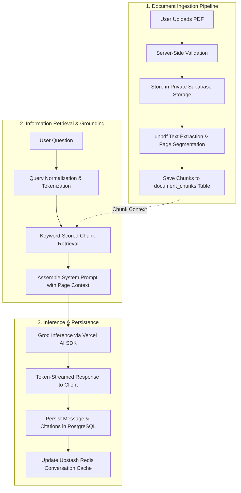
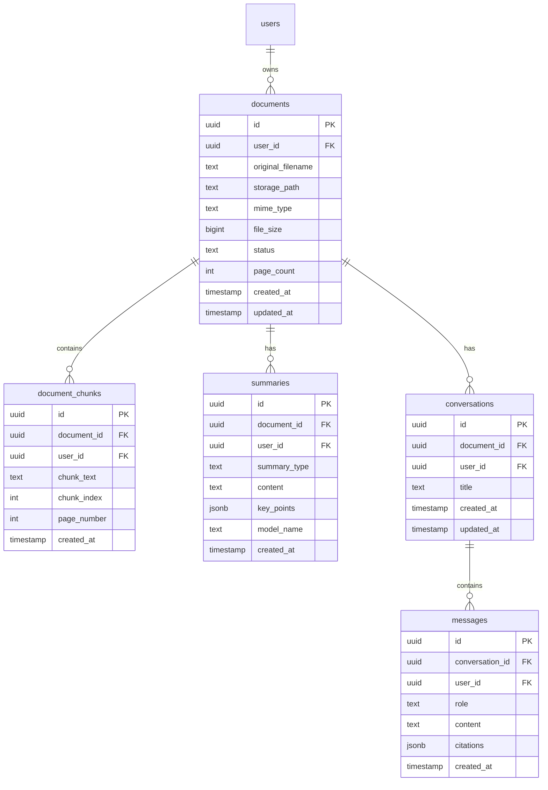

# DocuMind — AI-Powered PDF Workspace & Grounded Information Retrieval System

> **Laboratory Practice III (LP-3) — Information Retrieval (IR) Mini-Project**  
> Built with Next.js 16 (App Router), TypeScript, Tailwind CSS v4, shadcn/ui, Supabase (PostgreSQL, Auth, Storage, RLS), Groq (`openai/gpt-oss-20b`), and Upstash Redis.

[](https://nextjs.org/)
[](https://www.typescriptlang.org/)
[](https://tailwindcss.com/)
[](https://supabase.com/)
[](https://groq.com/)
[](https://upstash.com/)
[](https://sdk.vercel.ai/)

---

## 1. Project Overview & Problem Statement

Modern research papers, legal contracts, technical manuals, and academic textbooks are densely packed with information. Users typically spend hours manually skimming documents or struggle with generic large language models (LLMs) that hallucinate, miss critical nuances, or cannot cite their exact sources.

**DocuMind** is an enterprise-grade, document-grounded AI assistant engineered to address these challenges. By integrating an authenticated document management system with an Information Retrieval (IR) pipeline, DocuMind allows users to:
1. **Privately upload PDFs** into an isolated cloud vault.
2. **Extract page-aware text chunks**, preserving physical page boundaries.
3. **Generate structured summaries** at varying levels of analytical depth (Short, Medium, Detailed).
4. **Interact via a conversational AI chat**, receiving streamed, strictly grounded answers accompanied by verified page citations (`Page 2`, `Page 5`).

---

## 2. Information Retrieval (IR) Architecture

DocuMind treats document comprehension as a multi-stage Information Retrieval and Question Answering task.



### Retrieval & Grounding Highlights
- **Page-Aware Chunking:** During ingestion, `unpdf` parses the PDF stream and divides text into discrete chunks linked directly to their physical `page_number`.
- **Query Resolution:** Incoming chat questions are evaluated against extracted document chunks to select the most relevant passages.
- **Strict Grounding Guardrails:** System prompts instruct the LLM to base its reasoning exclusively on the supplied document excerpts, preventing hallucinations and citing the relevant source pages.
- **Dual Caching Layer:**
  - **Summary Cache:** Upstash Redis caches generated summaries with a 24-hour TTL using composite keys (`userId:documentId:type`).
  - **Chat History Cache:** Recent conversation turns are cached in Redis (`documind:chat:v1:<userId>:<conversationId>`) with fallback to PostgreSQL.

---

## 3. Key Features

### 📄 Secure PDF Vault & Management
- Multi-tenant storage using private Supabase Storage buckets.
- Strict Row-Level Security (RLS) guaranteeing users can only view, process, or download their own documents.
- Time-limited signed URLs (`createSignedUrl`) for viewing source PDFs without exposing public URLs.
- Modern drag-and-drop uploader with real-time progress indicators, file type validation, and 10MB size limits.

### ⚡ Multi-Tier AI Summarization
- **Short Summary:** High-level executive overview for rapid skimming.
- **Medium Summary:** Core themes, methodologies, and structured insights.
- **Detailed Summary:** Comprehensive breakdown with in-depth analysis and bulleted takeaways.
- Markdown formatting with formatted tables, bold text, and JSON-persisted key points.

### 💬 State-of-the-Art Document Chat
- Real-time token streaming powered by Groq (`openai/gpt-oss-20b`) via the Vercel AI SDK.
- **Full-Screen Workspace Modal:** Seamless, distraction-free environment with tab navigation between **Chatbot**, **Summarizer**, and **Saved Summaries**.
- **Modern Floating Input Dock:**
  - Auto-expanding borderless textarea that scales cleanly up to 180px.
  - Natural keyboard ergonomics: `Enter` to send, `Shift + Enter` for new lines.
  - Integrated `Send 🡑` action button with gradient glow and hover elevation.
  - Context badge displaying current document name and grounded status.
- **Interactive Starter Prompts:** Quick-start cards for *Key Takeaways*, *Methodology & Data*, and *Limitations & Risks*.
- **Source Page Chips:** Interactive citations linking directly to document page numbers.
- **One-Click Copy:** Assistant messages feature instant clipboard copy with visual feedback.

### 🛡️ Rate Limiting & Abuse Prevention
- Configured with `@upstash/ratelimit` via sliding window algorithm:
  - **Summarization:** 5 requests per user per minute.
  - **Chat:** 20 requests per user per minute.

---

## 4. System Architecture & Tech Stack

| Layer | Component | Description |
|---|---|---|
| **Framework** | Next.js 16.4.2 (Turbopack) | App Router, Server Components, Route Handlers, Cache Components |
| **Language** | TypeScript 5.x | Strict type safety across frontend and API contracts |
| **Styling** | Tailwind CSS v4 | Modern design tokens, HSL/OKLCH color palettes, custom scrollbars |
| **UI Primitives** | shadcn/ui on Base UI | Accessible, high-craft components without runtime bloat |
| **Icons** | `@phosphor-icons/react` | Modern duotone icon set |
| **Database** | Supabase PostgreSQL | Relational storage for documents, chunks, summaries, conversations, messages |
| **Authentication** | Supabase Auth | Google OAuth SSO with developer authentication fallback |
| **File Storage** | Supabase Storage | Private `documents` bucket with user-scoped storage policies |
| **PDF Extraction** | `unpdf` | Server-side PDF parsing and page-segmented text extraction |
| **AI Engine** | Vercel AI SDK (`ai`) | Stream management, unified LLM orchestration |
| **Model Provider** | Groq (`@ai-sdk/groq`) | Ultra-fast inference with `openai/gpt-oss-20b` |
| **Cache & Rate Limit** | Upstash Redis | Serverless Redis for request rate-limiting and conversation caching |
| **Markdown** | `react-markdown` + `remark-gfm` | Safe rendering of markdown tables, lists, and code blocks |

---

## 5. Database Schema & Data Models

The PostgreSQL database enforces relational integrity, foreign key cascading, and Row-Level Security (RLS) across all tables:



### Row Level Security (RLS) Policies
- Every table has RLS enabled (`ALTER TABLE ... ENABLE ROW LEVEL SECURITY`).
- Policies enforce `auth.uid() = user_id` for all `SELECT`, `INSERT`, `UPDATE`, and `DELETE` operations.
- Storage objects enforce `<auth.uid()>/<document_id>/<filename>` path verification.

---

## 6. API Route Specifications

### `POST /api/documents/process`
Extracts text from an uploaded PDF and persists page-segmented chunks.
- **Request:** `{ documentId: string }`
- **Actions:** Verifies ownership, downloads private PDF from Supabase Storage, extracts text via `unpdf`, inserts chunks into `document_chunks`, updates `documents.status` to `ready`.
- **Response:** `{ success: true, pageCount: number, chunkCount: number }`

### `POST /api/documents/summarize`
Generates an AI summary for a processed document.
- **Request:** `{ documentId: string, summaryType: "short" | "medium" | "detailed" }`
- **Rate Limit:** 5 requests/min per user.
- **Cache:** Checks Upstash Redis before inference; writes to PostgreSQL and Redis upon completion.
- **Response:** `{ summary: string, keyPoints: string[], model: string, cached: boolean }`

### `POST /api/documents/chat`
Streams document-grounded responses using Groq.
- **Request:** `{ documentId: string, conversationId?: string, message: string }`
- **Rate Limit:** 20 requests/min per user.
- **Headers Returned:**
  - `X-Conversation-Id`: Current or newly created conversation UUID.
  - `X-Citation-Pages`: Comma-separated list of cited page numbers (e.g. `2, 5`).
- **Response:** UTF-8 text stream (`ReadableStream`).

### `GET /api/documents/chat`
Retrieves conversation history for a document.
- **Query Params:** `?documentId=<uuid>&conversationId=<uuid>`
- **Cache:** Reads from Upstash Redis if cached; falls back to PostgreSQL.
- **Response:** `{ conversations: Conversation[], messages: StoredMessage[] }`

---

## 7. Directory Structure

```text
documind/
├── app/
│   ├── (auth)/
│   │   ├── auth/callback/route.ts       # OAuth redirect and exchange handler
│   │   ├── login/page.tsx               # Login screen with Google OAuth
│   │   └── signup/page.tsx              # Signup screen
│   ├── dashboard/
│   │   ├── page.tsx                     # Main authenticated dashboard shell
│   │   └── components/
│   │       ├── document-uploader.tsx    # Drag-and-drop PDF upload zone
│   │       ├── document-library.tsx     # Document list & full-screen modal workspace
│   │       ├── document-summarizer.tsx  # Multi-length summary generator
│   │       ├── document-chat.tsx        # Modern streaming chat & grounded input dock
│   │       ├── dashboard-sidebar.tsx    # Responsive collapsible sidebar navigation
│   │       └── user-account-modal.tsx   # Account details & session management
│   ├── api/
│   │   └── documents/
│   │       ├── process/route.ts         # PDF text extraction and chunk persistence
│   │       ├── summarize/route.ts       # Groq AI summarization and Redis caching
│   │       └── chat/route.ts            # Grounded chat streaming and persistence
│   ├── globals.css                      # Tailwind v4 theme tokens and custom scrollbars
│   └── layout.tsx                       # Root layout with Geist font loading
├── components/
│   └── ui/                              # shadcn/ui Base UI primitives (button, card, dialog, etc.)
├── lib/
│   ├── redis.ts                         # Upstash Redis client and rate limiters
│   ├── utils.ts                         # Class merging and formatting utilities
│   └── supabase/
│       ├── client.ts                    # Browser-side Supabase client
│       ├── server.ts                    # Server-side Supabase client (cookies)
│       └── proxy.ts                     # Session refresh helper
├── PRD.md                               # Comprehensive Product Requirements Document
├── AGENTS.md                            # Coding guidelines and technical invariants
└── package.json                         # Dependencies and build scripts
```

---

## 8. Getting Started & Installation

### Prerequisites
- Node.js 20.x or higher
- `pnpm` (v9 or higher recommended)
- A Supabase account and project
- A Groq Cloud API key
- An Upstash Redis database

### 1. Clone the Repository
```bash
git clone https://github.com/your-username/documind.git
cd documind
```

### 2. Configure Environment Variables
Create a `.env.local` file in the root directory:

```dotenv
# Supabase Configuration
NEXT_PUBLIC_SUPABASE_URL=https://your-project.supabase.co
NEXT_PUBLIC_SUPABASE_PUBLISHABLE_KEY=your-supabase-publishable-key

# AI Model Provider (Groq)
GROQ_API_KEY=gsk_your_groq_api_key_here

# Caching & Rate Limiting (Upstash Redis)
UPSTASH_REDIS_REST_URL=https://your-instance.upstash.io
UPSTASH_REDIS_REST_TOKEN=your_upstash_rest_token_here
```

### 3. Database & Storage Setup (Supabase)
Run the following SQL migrations in your **Supabase SQL Editor**:

```sql
-- 1. Create Documents table
create table public.documents (
    id uuid primary key default gen_random_uuid(),
    user_id uuid references auth.users(id) on delete cascade not null,
    original_filename text not null,
    storage_path text not null,
    mime_type text not null default 'application/pdf',
    file_size bigint not null default 0,
    status text not null default 'uploaded',
    page_count int default null,
    created_at timestamptz default now() not null,
    updated_at timestamptz default now() not null
);

-- 2. Create Document Chunks table
create table public.document_chunks (
    id uuid primary key default gen_random_uuid(),
    document_id uuid references public.documents(id) on delete cascade not null,
    user_id uuid references auth.users(id) on delete cascade not null,
    chunk_text text not null,
    chunk_index int not null,
    page_number int not null,
    created_at timestamptz default now() not null
);

-- 3. Create Summaries table
create table public.summaries (
    id uuid primary key default gen_random_uuid(),
    document_id uuid references public.documents(id) on delete cascade not null,
    user_id uuid references auth.users(id) on delete cascade not null,
    summary_type text not null,
    content text not null,
    key_points jsonb default '[]'::jsonb,
    model_name text,
    created_at timestamptz default now() not null
);

-- 4. Create Conversations & Messages tables
create table public.conversations (
    id uuid primary key default gen_random_uuid(),
    document_id uuid references public.documents(id) on delete cascade not null,
    user_id uuid references auth.users(id) on delete cascade not null,
    title text not null default 'New Conversation',
    created_at timestamptz default now() not null,
    updated_at timestamptz default now() not null
);

create table public.messages (
    id uuid primary key default gen_random_uuid(),
    conversation_id uuid references public.conversations(id) on delete cascade not null,
    user_id uuid references auth.users(id) on delete cascade not null,
    role text not null check (role in ('user', 'assistant')),
    content text not null,
    citations jsonb default '[]'::jsonb,
    created_at timestamptz default now() not null
);

-- 5. Enable Row-Level Security
alter table public.documents enable row level security;
alter table public.document_chunks enable row level security;
alter table public.summaries enable row level security;
alter table public.conversations enable row level security;
alter table public.messages enable row level security;

-- 6. Add RLS Policies
create policy "Users own documents" on public.documents for all using (auth.uid() = user_id);
create policy "Users own chunks" on public.document_chunks for all using (auth.uid() = user_id);
create policy "Users own summaries" on public.summaries for all using (auth.uid() = user_id);
create policy "Users own conversations" on public.conversations for all using (auth.uid() = user_id);
create policy "Users own messages" on public.messages for all using (auth.uid() = user_id);
```

Create a **Private Storage Bucket** in Supabase named `documents` and configure its policy:
```sql
create policy "Users can access own document files"
on storage.objects for all
using (bucket_id = 'documents' and (storage.foldername(name))[1] = auth.uid()::text);
```

### 4. Install Dependencies & Launch
```bash
# Install packages
pnpm install

# Start local development server
pnpm dev
```
Open [http://localhost:3000](http://localhost:3000) in your browser.

---

## 9. Quality Verification & Build

```bash
# Type check TypeScript codebase
pnpm exec tsc --noEmit

# Run ESLint validation
pnpm run lint

# Build production bundle
pnpm run build
```

---

## 10. Future Roadmap (Phase 2)

- **Vector Search with `pgvector`:** Transition from lexical matching to hybrid search using dense vector embeddings (e.g. `text-embedding-3-small` or BGE models).
- **OCR Pipeline:** Optical Character Recognition for scanned images and non-selectable PDFs via Tesseract or cloud vision models.
- **Cross-Document Synthesis:** Multi-document chat allowing comparison across multiple PDFs in the library.
- **Interactive Citation Highlighter:** Clicking a `Page X` citation chip automatically jumps to and highlights the excerpt in a built-in PDF reader.

---

## 11. Authors & License

- **Course:** Laboratory Practice III (LP-3) — Information Retrieval (IR)
- **Institution:** SPPU / BE Computer Engineering
- **Developer:** Niraj Salunke
- **License:** MIT License
